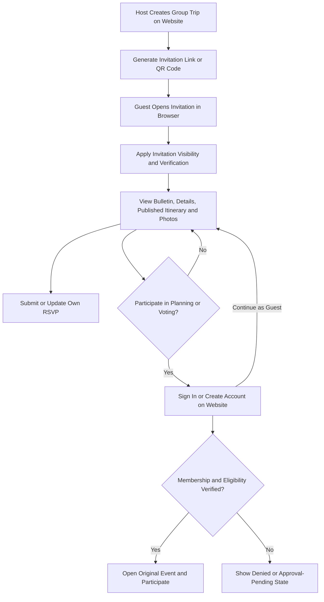

# Go Liaise — PRD: Web-First Solo and Group Trip Planning

**Product Name:** Go Liaise  
**Previous Name:** Crewly  
**PRD Version:** 1.4  
**Status:** Web-First and Solo Trip Requirements Approved — Architecture and UI/UX Revisions Pending

---

## 1. Product Branding Update

The application will officially be named **Go Liaise**.

All product documentation, UI/UX specifications, navigation elements, feature descriptions, and future development references must use the name Go Liaise.

### Branding Requirements

- **BR-001:** Replace all references to "Crewly" with "Go Liaise".
- **BR-002:** Display "Go Liaise" on the welcome screen, authentication screens, and application headers.
- **BR-003:** Use Go Liaise branding across the registered-user website, guest website, and future native mobile companions.
- **BR-004:** Maintain consistent branding across invitation links, emails, notifications, and QR codes.
- **BR-005:** Apply a unified visual identity across desktop web, mobile web, and future iOS/Android companions.

---

## 2. Product Strategy and Guest Access

### 2.1 Web-First Overview

Go Liaise supports three experiences:

1. **Registered-User Website:** The primary application for account creation, solo and group trip/event creation, itinerary planning, and collaboration. It must be responsive on desktop and phone browsers.
1. **Guest Website:** Accountless access to host-permitted event information and RSVP through secure invitations.
1. **Native Mobile Companion:** A later iOS/Android release for convenient trip access and phone-native actions, especially capturing or selecting photos and uploading them directly to the correct event.

The website launches first as a complete planning experience. Native installation is optional and is not required for core planning or collaboration. Mobile scope can expand through future product decisions; full planning parity is not a prerequisite for the first native release.

A trip and its event content use one shared trip/event record. Solo and group are modes of that record, not separate applications or duplicated itineraries.

### 2.2 Guest Access Requirements

Invited guests can use a secure invitation link without downloading Go Liaise or creating a permanent account to:

- View the event bulletin board and published announcements.
- View permitted event details and host-published itineraries.
- Submit and update their own RSVP.
- Browse available albums and host-approved photos.

These are required MVP guest capabilities. Unpublished or restricted content stays private. Guest photo access is read-only; uploading, editing, deleting, and commenting are unavailable to accountless guests.

Hosts can create scannable QR invitations from the website. Passwordless verification or host approval may be required by invitation policy. Advanced collaboration requires an authenticated, eligible participant, who can participate on the website without installing an app.

### 2.3 Release Boundaries

- **Website MVP:** Account creation/sign-in, solo/group trip creation and settings, itinerary planning, private personal notes, announcements, eligible participant voting, participant/invitation/QR management, authorized photo uploads, and existing accountless guest capabilities.
- **Later mobile companion:** Existing-account sign-in, viewing solo/group plans, eligible voting, updates, and camera/photo-library uploads to the same trips. Tasks and expenses become companion candidates only if separately approved and implemented.
- **Still proposed:** Expense management, tasks, live location, and secure accommodation details. Their placement in a platform matrix does not approve them for MVP.
- **Deferred decisions:** Native account creation, full mobile planning parity, group-to-solo conversion, offline uploads, and background uploads.

---

## 3. Feature Access Matrix

| Feature | Guest Web | Registered Web | Mobile Companion | Release / Requirement Status |
|---|---|---|---|---|
| Create Account | No account required for guest access | Yes | Deferred; sign in to existing account | Approved — website MVP |
| Sign In / View Own Trips | No | Yes | Yes, existing account | Web MVP; mobile later |
| Create Solo or Group Trip / Manage Settings | No | Yes, owner | Future expansion decision | Approved — website MVP |
| Plan Itinerary / Organize Personal Notes | Published itinerary only; no notes | Yes, authorized role; notes private to author | View plans; editing scope may expand | Approved — website MVP |
| View Bulletin / Announcements / Event Details | Host-permitted content | According to membership and role | According to membership and role | Web MVP; mobile later |
| Publish Announcements | No | Authorized host/organizer | Future expansion decision | Approved — website MVP |
| Submit / Update Own RSVP | Yes | Yes, where applicable | Later, where applicable | Approved — website MVP; hidden for solo trips |
| View Photo Albums | Published, host-approved, read-only | According to permissions | According to permissions | Web MVP; mobile later |
| Manage Participants / Invitation QR Codes | No | Authorized host | Future expansion decision | Approved — website MVP |
| Vote on Itinerary Activities | No | Eligible authenticated participant | Eligible authenticated participant | Web MVP; mobile later; hidden for solo trips |
| Upload Trip Photos | No | Authorized owner/participant | Camera or photo-library upload | Approved — website MVP; mobile later |
| Manage Group Expenses | No | Proposed | Proposed | Proposed — not approved for MVP |
| Access Live Group Map | No | Proposed, subject to browser capabilities | Proposed | Proposed — not approved for MVP |
| Create or Complete Tasks | No | Proposed | Proposed | Proposed — not approved for MVP |
| Access Secure Accommodation Details | No | Proposed, authorized roles only | Proposed, authorized roles only | Proposed — not approved for MVP |

### Access Control Rules

1. Guests need neither installation nor permanent accounts for permitted content and RSVP.
1. Registered web access supports core planning and collaboration without a native app.
1. The backend enforces trip ownership, membership, role, invitation, and resource permissions on every client.
1. Hosts control guest-visible content; an invitation URL or authenticated account alone does not grant unrestricted membership.
1. Solo trips are owner-only by default, including itinerary, personal notes, albums, and media.
1. Native download links are optional and displayed only when the apps are available.

---

## 4. Guest Invitation User Experience

### 4.1 Primary Guest Flow

1. A host creates a group trip/event on the Go Liaise website.
2. The host generates an invitation link and can create a QR code for it.
3. The host shares the link through SMS, WhatsApp, email, or QR code.
4. The guest taps the invitation link or scans the QR code and opens its link.
5. The link opens the Go Liaise guest web experience.
6. The guest views the event bulletin board.
7. The guest can read the available bulletin and announcements, review event details and published itineraries, view available photo albums, and submit or update an RSVP.
8. The guest may continue browsing without downloading the application.
9. If the guest attempts a participant-only action, Go Liaise offers website sign-in or account creation while preserving the invitation and event context.
10. The backend verifies invitation conditions and membership/eligibility before permitting the action. Account creation alone does not grant participant access.
11. The guest may dismiss the prompt and continue browsing. A later optional mobile handoff also preserves the event context.

### 4.2 UX Flow Diagram

---

## 5. Guest Web Functional Requirements

| Requirement ID | Feature | Description |
|---|---|---|
| GL-GUEST-01 | Browser Event Access | Guests can open event invitations in a desktop or mobile browser without installing Go Liaise. |
| GL-GUEST-02 | Guest Bulletin Board | Guests can view host-approved bulletin board content. |
| GL-GUEST-03 | Announcements and Event Details | Guests can read published announcements and permitted event details. |
| GL-GUEST-04 | Browser RSVP | Guests can submit and update RSVPs without creating permanent accounts. |
| GL-GUEST-05 | Read-Only Itinerary | Guests can view host-published itineraries as an MVP capability but accountless guests cannot cast votes; eligible registered users can vote in the browser. |
| GL-GUEST-06 | Participant Sign-In Prompts | Participant-only actions offer website sign-in/account creation and a return-to-guest option; installation is not required. |
| GL-GUEST-07 | Passwordless Verification | Guests can verify their identity using email or SMS codes when required. |
| GL-GUEST-08 | Invitation Security | Hosts can revoke invitations, configure visibility, and require guest approval. |
| GL-GUEST-09 | Cross-Platform Synchronization | Guest RSVPs and permitted changes appear in registered web and, when released, mobile companions through shared trip data. |
| GL-GUEST-10 | Authentication and Optional Mobile Handoff | Website sign-in/account creation preserves invitation/event context and verifies access before participation. A later optional mobile handoff returns authorized users to the correct event. |
| GL-GUEST-11 | Guest Photo Albums | Guests can browse available albums and open host-approved photos without installing the app or creating a permanent account. Guest photo access is read-only. |
| GL-GUEST-12 | QR Invitation Access | Scanning a host-generated QR invitation opens the same event and permission-controlled guest experience as its invitation link. |
| GL-GUEST-13 | Guest Content Visibility | The backend applies host visibility settings to bulletins, itineraries, albums, and individual photos, including direct requests for media. |

---

## 6. Guest Web Screen Inventory

### GW-01: Guest Invitation Landing Page

**Purpose:** Introduce the event and provide immediate access to permitted information.

**Displayed Information:**
- Go Liaise branding
- Event cover image
- Event name
- Event date and time
- Event location
- Host name, if permitted
- Short event description

**Buttons and Navigation:**

| Button | Action | Destination |
|---|---|---|
| View Bulletin Board | Opens event bulletin | GW-02 |
| View Event Details | Opens event information | GW-04 |
| RSVP | Opens RSVP interface | GW-05 |
| View Itinerary | Opens the host-published schedule, if available | GW-06 |
| View Photos | Opens available event photo albums | GW-08 |
| Sign In / Create Account | Opens website authentication with event context | RW-01 |
| Get Mobile Companion (when available) | Optionally opens the appropriate application store | App Store / Google Play |

### GW-02: Guest Bulletin Board

**Purpose:** Allow invited guests to read event updates without downloading the application.

**Features:**
- Announcement feed
- Pinned announcements
- Event updates
- Important instructions
- Publication timestamps

**Buttons and Navigation:**

| Button | Action | Destination |
|---|---|---|
| Announcement Card | Opens full announcement | GW-03 |
| Event Details | Opens event information | GW-04 |
| RSVP | Opens RSVP interface | GW-05 |
| Itinerary | Opens published schedule | GW-06 |
| Photos | Opens available event photo albums | GW-08 |
| Back | Returns to event landing page | GW-01 |

### GW-03: Announcement Details

**Purpose:** Display the full contents of a selected announcement.

**Features:**
- Announcement title
- Announcement body
- Publication date
- Host information, if permitted
- Attached media, if enabled

**Buttons and Navigation:**

| Button | Action | Destination |
|---|---|---|
| Back | Returns to bulletin board | GW-02 |
| View Event | Returns to event landing page | GW-01 |

### GW-04: Event Details

**Purpose:** Provide essential event information to invited guests.

**Features:**
- Event name and description
- Date and time
- Location
- Dress code, if applicable
- Host-approved instructions
- Published itinerary link
- Available photo albums link

**Buttons and Navigation:**

| Button | Action | Destination |
|---|---|---|
| RSVP | Opens RSVP interface | GW-05 |
| View Itinerary | Opens published itinerary | GW-06 |
| View Bulletin | Opens bulletin board | GW-02 |
| View Photos | Opens available event photo albums | GW-08 |
| Back | Returns to event landing page | GW-01 |

### GW-05: Guest RSVP

**Purpose:** Allow invited guests to respond without creating a permanent account.

**Features:**
- Attendance selection
- Optional guest name confirmation
- Passwordless verification when required
- RSVP confirmation
- Ability to update RSVP if permitted

**Buttons and Navigation:**

| Button | Action | Destination |
|---|---|---|
| I'm Going | Selects attending status | RSVP Form |
| Can't Attend | Selects declined status | RSVP Form |
| Submit RSVP | Saves verified response | Confirmation |
| Update RSVP | Modifies existing response | RSVP Form |
| Return to Event | Opens event landing page | GW-01 |

### GW-06: Guest Itinerary

**Purpose:** Allow guests to view published event activities without using the native application.

**Features:**
- Activity timeline
- Activity descriptions
- Scheduled times
- Locations
- Published cost estimates
- Read-only voting options, if permitted

**Buttons and Navigation:**

| Button | Action | Destination |
|---|---|---|
| View Activity | Opens activity information | Activity Details |
| Cast Vote | Offers website sign-in or account creation | GW-07 |
| Back | Returns to event details | GW-04 |

### GW-07: Sign In or Create Account to Participate

**Purpose:** Offer authenticated website participation while preserving accountless guest access.

**Suggested Message:** "Sign in or create a Go Liaise account to participate in planning and vote, subject to the host's access settings."

| Button | Action | Destination |
|---|---|---|
| Sign In | Authenticate and preserve invitation/event context | RW-01 |
| Create Account | Register on the website and preserve invitation/event context | RW-01 |
| Continue as Guest | Return without registering | Previous guest screen |

After authentication, the backend checks invitation conditions, membership, and eligibility. Show access-denied or approval-pending states when appropriate; do not grant membership merely because an account exists.

---

### GW-08: Guest Photo Albums

**Purpose:** Let guests browse available event albums and view permitted photos without installing Go Liaise or creating a permanent account.

**Features:**

- Host-published album list with titles and permitted cover images.
- Selected-album photo grid and full-size photo viewer, with captions when available.
- Loading, no-published-albums, empty-album, failed-image/retry, and access-unavailable states.
- Read-only guest access; no upload, edit, delete, or comment controls.
- Access checks for album metadata, thumbnails, and full-size images; hidden photos must not leak through covers or previews.

**Buttons and Navigation:**

| Button | Action | Destination |
|---|---|---|
| Album Card | Opens permitted photos in the selected album | GW-08 album grid |
| Photo Thumbnail | Opens the selected photo | GW-08 photo viewer |
| Previous / Next | Displays another permitted photo | GW-08 photo viewer |
| Close Photo | Returns to the selected album | GW-08 album grid |
| Back to Albums | Returns to available albums | GW-08 album list |
| Return to Event | Opens event landing page | GW-01 |

Album grids and the photo viewer are states of GW-08 for MVP planning. Unavailable content shows an explanatory state without revealing private titles or images.

---

## 7. Authenticated Participant Voting

### 7.1 Functional Requirements

- Eligible authenticated participants can vote through the registered website and later through the mobile companion.
- Accountless guests may view options if permitted but cannot submit votes.
- The backend verifies event membership, voting eligibility, poll closing time, and duplicate-vote rules on every submission.
- Hosts configure closing times and result visibility.
- Solo trips do not show voting controls; their owner directly organizes the itinerary.

### 7.2 Participation Prompt

- A guest selecting a participant-only action sees GW-07 with website sign-in/account creation and a dismissible return-to-guest option.
- Preserve the original invitation/event and intended action through authentication; never cast a vote automatically after sign-in.
- Native installation is optional. Do not redirect guests automatically to an app store.

---

## 8. Invitation Security and Privacy

### 8.1 Invitation Types

**Personalized Invitations**
- Generated for specific recipients.
- Support individual RSVP tracking.
- May require identity verification.
- Can be revoked independently.

**General Invitation Links**
- Can be shared with multiple recipients.
- Provide only host-approved preview information.
- May require verification or host approval before granting private event access.

### 8.2 Security Requirements

- Invitation tokens must be unpredictable.
- Invitation links must support revocation.
- Private event information must be protected by backend permissions.
- Sensitive actions may require passwordless identity verification.
- Guest sessions must have appropriate expiration policies.
- Revoked invitations must stop granting access.
- RSVP submissions must be protected against unauthorized modification.
- Invitation URLs must not expose unnecessary personal information.

---

## 9. Technical Architecture

Go Liaise will use a shared backend serving both native and web experiences.

### Architecture Components

| Component | Responsibility |
|---|---|
| Registered Web Application | Primary responsive account, solo/group planning, collaboration, and upload experience; launches first |
| iOS Companion | Later existing-account access, plans, voting, updates, and camera/photo-library uploads |
| Android Companion | Later existing-account access, plans, voting, updates, and camera/photo-library uploads |
| Guest Web Application | Browser-based access to permitted event information |
| Backend API | Centralized business logic and permission enforcement |
| Authentication Service | Registered account authentication and guest verification |
| Invitation Service | Token generation, validation, expiration, revocation, and host QR invitation management |
| Event Database | Stores shared solo/group trip/event records, owners/members, private personal notes, announcements, RSVPs, itineraries, album/photo metadata, and audience settings |
| Media Storage | Stores event images, album photos, and attachments with permission-controlled delivery |
| Notification Service | Delivers event updates and invitation notifications |

### Technical Requirements

- Native and web experiences must use the same event data.
- Changes made in one experience must synchronize with the other.
- Invitation links should support iOS Universal Links and Android App Links.
- Registered and guest web pages must be responsive on supported desktop and phone browsers.
- Web and mobile use the same account identities, trip membership, backend, and media store; mobile sign-in retrieves existing trips without duplicating accounts.
- Solo/group modes share one record and stable trip identity. Personal-note author access is separate from shared itinerary access.
- Website launch does not depend on native clients, store availability, or native-only handoff mechanisms.
- App installation handoff must preserve event and invitation identifiers.
- Authorization must be enforced on the backend rather than relying on hidden interface elements.
- Browser limitations must be considered when implementing future location and notification features.
- Guest album metadata and photo delivery must enforce the same invitation/session and visibility rules as other private event content. Revocation must prevent future protected requests, including from previously established guest sessions; it cannot erase photos already viewed or saved.

---

## 10. Acceptance Criteria

| ID | Acceptance Criteria |
|---|---|
| AC-01 | A guest can open a valid invitation link without installing Go Liaise. |
| AC-02 | A guest can view the event bulletin board without registering. |
| AC-03 | A guest can read host-approved announcements. |
| AC-04 | A guest can view permitted event details. |
| AC-05 | A guest can submit an RSVP without creating a permanent account. |
| AC-06 | The host can view submitted RSVPs on the registered website; the mobile companion can provide access later. |
| AC-07 | An accountless guest cannot cast votes; an authenticated eligible participant can vote through the browser. |
| AC-08 | An accountless guest attempting to vote sees website sign-in/account creation with preserved invitation/event context. |
| AC-09 | A guest can dismiss the participation prompt and continue browsing without creating an account. |
| AC-10 | Website authentication returns the user to the original event, subject to membership/eligibility checks; later optional mobile handoff preserves the same context. |
| AC-11 | Revoked invitations no longer grant access to protected content. |
| AC-12 | Unauthorized users cannot retrieve private event information through direct API requests. |
| AC-13 | Changes to announcements and event details appear in guest and registered web according to permissions, and in mobile companions when released. |
| AC-14 | Registered and guest web experiences work on supported desktop, iOS, and Android browsers with keyboard and assistive-technology access. |
| AC-15 | A guest can view a host-published itinerary without installing the app or creating a permanent account. |
| AC-16 | A guest can browse available photo albums and view permitted photos without installing the app or creating a permanent account. |
| AC-17 | Unpublished/restricted albums and photos are inaccessible through guest navigation and direct metadata, thumbnail, or image requests. |
| AC-18 | Guest album viewing supports empty, loading, image-error, and access-unavailable states without exposing private content. |
| AC-19 | An authorized host can generate, preview, share, and download an invitation QR code from the registered website event screen. |
| AC-20 | A QR code scanned from another screen or a printed invitation on supported iOS/Android devices opens the correct guest event without requiring Go Liaise installation. |
| AC-21 | A QR invitation grants exactly the same access as its underlying invitation link and does not automatically submit an RSVP or record attendance. |
| AC-22 | Expired or revoked QR invitations show an access-unavailable message and cannot retrieve protected content; replacing one invalidates the old invitation and code. |
| AC-23 | Multiple guests using a general QR invitation can submit separate RSVPs; one guest cannot overwrite another guest's response. |
| AC-24 | A guest can update their own RSVP using their authorized guest session or required passwordless verification. |
| AC-25 | Changing permitted event content updates the guest experience without requiring a new QR code, provided its invitation remains active. |
| AC-26 | Cross-event/role access, revoked sessions, direct photo URLs, and unauthorized RSVP changes fail in automated security tests. |
| AC-27 | Registered users and accountless guests can submit appropriate data requests; deletion and retention behavior is documented and tested across active stores, backups, and vendors. |
| AC-28 | Guests can report inappropriate photos/content without creating an account, and the responsible moderation team can process the report. |
| AC-29 | Website launch evidence includes reviewed legal applicability and public policies, web/vendor disclosures, security verification/retests, and incident/restore exercises as defined in Section 14. Native controls and store disclosures are required for the later native release. |
| AC-30 | A user can create an account, sign in, create a solo or group trip, and manage its itinerary and settings entirely on the website without native installation. |
| AC-31 | A solo traveler can set destinations, dates, trip details, activities, personal notes, and organize photos without another participant or invitation. |
| AC-32 | Other users cannot retrieve a solo trip or its notes/media through navigation, direct URLs, APIs, or media requests. Solo screens hide RSVP summaries, voting, and participant-management prompts. |
| AC-33 | An owner can choose Invite Others, review the proposed group audience and shared content, cancel without changes, or confirm conversion. Confirmation preserves the trip ID, itinerary, and photos; access still requires valid invitation/membership permissions. |
| AC-34 | Personal notes and unpublished photos remain private after solo-to-group conversion unless explicitly shared by the owner; existing media URLs and direct API requests cannot bypass visibility. |
| AC-35 | Authorized web users can select the trip/album, upload photos, and see progress, success, validation/access failure, and retry states; accountless guests cannot upload. |
| AC-36 | The website can launch and complete core planning/collaboration with native clients unavailable; no required planning action leads to an app-installation gate. |
| AC-37 | On the later native release, an existing website account opens its solo/group plans and can upload camera/library photos into the selected trip/album, with destination confirmation and progress, success, permission-denied, and retry states. Shared data and visibility stay consistent across clients. |
| AC-38 | Signing in from an invitation does not itself grant membership, bypass host approval, or automatically submit a vote. |

---

## 11. Product Decisions and Approval Status

| Decision | Status |
|---|---|
| Rename Crewly to Go Liaise | Approved |
| Allow guest bulletin board access without installation | Approved |
| Allow guests to read announcements without installation | Approved |
| Allow guests to view event details without installation | Approved |
| Allow guests to RSVP without installation | Approved |
| Require native application for itinerary voting | Superseded by approved web-first participant voting |
| Responsive website is primary; web launches before native companions | Approved — website MVP |
| Website account creation and solo/group trip planning | Approved — website MVP |
| Private solo trips can become group trips through reviewed invitations | Approved — website MVP |
| Authorized browser photo uploads | Approved — website MVP |
| Later mobile companion with existing-account access and direct phone photo uploads | Approved direction — native release later; detailed UX pending |
| Expand mobile planning capabilities | Future product decisions; no permanent web-only restriction |
| Allow guests to view published itineraries | Approved — MVP |
| Allow guests to view available photo albums and photos, read-only | Approved — MVP |
| Allow hosts to create and manage scannable QR invitations | Approved — MVP |
| QR implementation approach in Section 13.3 | Recommended — architecture review pending |
| Security/privacy baseline and policy deliverables in Section 14 | Proposed — applicability and implementation review pending |
| Expense management | Proposed — not approved for MVP; no native-only restriction |
| Restrict photo uploads to native application | Superseded by approved web uploads and later mobile uploads |
| Live location sharing | Proposed — browser/platform feasibility and privacy review pending |
| Task management | Proposed — not approved for MVP; no native-only restriction |
| Require additional verification for sensitive information | Recommended |

---

## 12. Product Experience Principle

Go Liaise lets a traveler plan independently or collaborate with a group on the website. Mobile companions add convenient access during travel and can grow over time.

**Guests should never be forced to download Go Liaise simply to understand an event or respond to an invitation. Registered users should not need native installation to plan or collaborate.**

- **Solo:** Create Account → Create Solo Trip → Organize Itinerary → Travel → Add Photos → Optionally Invite Others.
- **Group:** Create Account → Create Group Trip → Invite Participants → Plan and Collaborate → Travel.
- **Guest:** Open Invitation → View Permitted Information → RSVP → Optionally Create Account to Participate.

---

## 13. Host QR Invitations

### 13.1 MVP Requirements

| Requirement ID | Feature | Description |
|---|---|---|
| GL-QR-01 | Create QR Invitation | An authorized host can create a QR code from the registered website event's Invite Guests screen. |
| GL-QR-02 | Invitation Settings | The host selects a general or personalized invitation and sets guest visibility, expiration, and verification/approval requirements using the existing invitation controls. |
| GL-QR-03 | Preview and Share | The host can preview the QR code, share it, download a PNG suitable for printing, and copy its equivalent invitation link. |
| GL-QR-04 | Browser Destination | The QR code opens the guest web landing page for the correct event; it must not send guests directly to an app store or require an app-only scanner. |
| GL-QR-05 | Revoke and Replace | The host can revoke an invitation or replace it with a new invitation token and QR code. Replacement invalidates the old link and QR code. |
| GL-QR-06 | Access Parity | QR access follows the same backend visibility, identity verification, approval, session expiration, and RSVP ownership rules as link access. Scanning alone does not identify a guest or count as RSVP/check-in. |

### 13.2 Host Screen: H-QR-01 — Invite Guests / QR Code

**Purpose:** Create and manage QR invitations within the registered website event experience. The owner of a solo trip reaches invitation management through the reviewed conversion flow in Section 15.

| Control | Action / Destination |
|---|---|
| Invitation Type | Select a general invitation or a recipient-specific invitation. |
| Guest Visibility | Select the bulletin, itinerary, albums/photos, and other event details guests may view. |
| Expiration / Verification / Approval | Configure the invitation's access conditions. |
| Generate QR Code | Creates the invitation and displays its QR preview and status. |
| Share QR / Download PNG | Shares or exports the generated QR image. |
| Copy Invitation Link | Copies the same URL encoded by the QR code. |
| Preview Guest Experience | Opens a preview under guest permissions, without elevated host access. |
| Revoke Invitation | Confirms revocation and marks the invitation inactive. |
| Replace QR Code | Confirms invalidation of the old invitation, then creates and displays its replacement. |

The screen includes generating, ready, failed/retry, expired, and revoked states. A generation failure must not display an unusable QR code as ready.

### 13.3 Suggested Implementation

This is the recommended MVP approach for architecture review; the QR feature itself is an approved requirement.

1. Reuse the invitation service. After checking host permissions, create an invitation record with an opaque, unpredictable token, event association, visibility policy, expiration, and optional recipient restriction.
1. Encode a first-party HTTPS guest URL such as `https://<guest-domain>/invite/<opaque-token>` in a standard QR image. The domain is a placeholder to be selected during architecture planning. Include only the invitation URL in the QR payload, not private event details or guest contact information.
1. Generate the image using a QR encoder appropriate to the selected application stack. A third-party QR hosting or redirect subscription is unnecessary for the MVP: the application owns the destination and invitation lifecycle.
1. Let guests use their device camera or QR reader, then open the detected URL. Keep a copyable/tappable link alongside the QR image for guests viewing an invitation on the same phone. iPhone supports opening QR links through its Camera app; see [Apple's scanning guidance](https://support.apple.com/en-gb/102680).
1. On opening the URL, validate the invitation and apply its visibility policy before returning protected content. A general QR code is shareable, not proof of identity: establish a separate guest identity/session for each respondent and use passwordless verification or host approval where required. Never use the shared QR token as the RSVP owner's identity.
1. Keep guest web access available even when Go Liaise is installed. When native companions are available, offer an optional Open App action; coordinate the guest URL path with the Universal/App Links configuration so it does not force an app-only experience.
1. Reuse the same QR while the invitation remains active; bulletin, itinerary, and album updates come from the backend. Revocation disables that invitation. Replacing it generates a new token and image, and the host must redistribute or reprint the replacement.
1. Use a high-contrast QR with an unobstructed quiet zone and test both printed and on-screen scans. Standard QR codes require a four-module margin on every side; see [DENSO WAVE's QR layout guidance](https://www.qrcode.com/en/howto/code.html/index.html). Keep branding outside the code for the initial release.

**Recommended default:** Use a general event QR for group sharing and printed invitations, with only host-approved preview content available before any required verification. Use personalized invitations when recipient-specific access or tracking is needed.

---

## 14. Security, Privacy, and Compliance Requirements

**Status:** Proposed implementation baseline; launch jurisdictions, age eligibility, payment scope, and final legal policies remain pending review.

Go Liaise must treat protection of guest identities, private event information, photos, and invitations as product requirements. Security frameworks provide engineering guidance; they do not establish legal compliance or guarantee protection from lawsuits.

The companion [Security, Privacy, and Compliance Requirements](Go-Liaise-Security-Privacy-Requirements.md) defines stable requirements `SECURITY-GL-001` through `SECURITY-GL-012`, policy deliverables, applicability questions, and development/release evidence.

### 14.1 Engineering Baseline

- Target OWASP ASVS Level 2 for web/API verification and applicable OWASP MASVS/MASTG controls for native applications.
- Use NIST SSDF for secure development and the NIST Privacy Framework for data-purpose, lifecycle, and privacy-risk management.
- Target WCAG 2.2 AA for the full registered and guest website and verify native accessibility separately.
- Enforce event/role/resource isolation, owner-only solo trips, private personal notes, reviewed solo-to-group sharing, invitation revocation, individual RSVP ownership, private photo delivery, administrator MFA, and secrets protection.
- Authorize and validate browser uploads before accepting or serving media; sharing a trip must not automatically publish its photos or personal notes.
- Provide member and accountless-guest data request/deletion paths, content reporting, documented retention, vendor review, and incident handling.
- Keep optional tracking and higher-risk features subject to an explicit data/permission review; guest access must not silently grant permission for marketing or background location collection.

### 14.2 Policy and Release Requirements

- Draft and obtain qualified legal review of the Privacy Notice, Terms/Acceptable Use, photo/content policy, and jurisdiction-specific requirements against actual deployed behavior.
- Maintain operational retention/deletion, secure development/access, incident response, vendor, and messaging/permission procedures with named owners.
- Release the website first with applicable web/API controls and disclosures. Review mobile-specific controls and Apple/Google requirements before the later native release and store submission; native readiness is not a website launch dependency.
- Map these requirements to architecture, individual screen specifications, implementation tickets, tests, and launch evidence using existing stage traceability. Public policies alone do not satisfy the controls.
- Do not mark the app compliant or these requirements implemented until evidence and applicability review exist. This PRD update does not run or approve any stage.

---

## 15. Solo Trip Planning

Solo planning is an approved website MVP capability. A solo trip has one owner and no additional participants; it uses the same trip record and itinerary capabilities as a group trip.

| Requirement ID | Feature | Required behavior |
|---|---|---|
| FEATURE-GL-SOLO-001 | Trip Mode Selection | Offer Solo Trip and Group Trip during website trip creation. Solo creation requires no invitations or other travelers. |
| FEATURE-GL-SOLO-002 | Personal Planning | Let the owner set destinations, dates, trip details, itinerary activities, and personal notes, and organize trip photos. The owner can edit plans directly without polls or RSVP. |
| FEATURE-GL-SOLO-003 | Owner-Only Access | Default all solo trip details, itinerary, notes, albums, and media to owner-only access. Enforce access on backend and direct media requests, not only in navigation. |
| FEATURE-GL-SOLO-004 | Solo Screen States | Reuse shared trip screens while hiding participant-management prompts, RSVP summaries, and voting. Offer a deliberate Invite Others action in trip settings rather than prompting for missing participants. |
| FEATURE-GL-SOLO-005 | Invite Later | Before creating an invitation, explain conversion to a group trip and show what itinerary/details will become shared and with whom. Allow cancellation without changes. On confirmation, preserve trip identity/content, change mode to group, and use normal invitation and membership checks. Confirmation can create a group trip with invitations pending; it grants no recipient access by itself. |
| FEATURE-GL-SOLO-006 | Preserve Private Content | Personal notes remain author-private unless the owner explicitly shares them. Existing unpublished photos remain private until explicitly published to a selected audience. Conversion does not bulk-publish content or weaken direct API/media permissions. |

**Traceability:** AC-30 through AC-34 validate these requirements. Trip creation, planning, settings, and album screens must reference the applicable `FEATURE-GL-SOLO-*` IDs in downstream specifications and tickets.

---

## 16. Registered Website Screen Inventory

These are functional screen definitions for downstream UX specification, not approved visual designs. Shared screens must include solo/group and role-specific states.

| Screen ID | Screen | Required behavior / navigation |
|---|---|---|
| RW-01 | Account Creation / Sign In | Website registration, sign-in, recovery, validation/error states, and return to the requested trip/action. Invitation context survives authentication; access-denied or approval-pending states are enforced before participation. |
| RW-02 | Trip Dashboard | List owned/joined trips, indicate solo/group mode, open an existing trip, and create a trip. Include empty, loading, and failed/retry states. |
| RW-03 | Create Trip | Select Solo Trip or Group Trip; enter destinations, dates, and trip details; save and open the trip workspace. Solo creation has no participant requirement. |
| RW-04 | Trip Workspace / Settings | View trip details and itinerary; edit according to role; access personal notes and albums. Solo state hides group controls and offers Invite Others with audience/content review, confirm, and cancel states before H-QR-01. |
| RW-05 | Itinerary Planning / Voting | Authorized users organize activities; solo owners edit directly. Group participants vote only when eligible. Personal notes stay private unless explicitly shared. Include empty itinerary, saved/error, poll-closed, and ineligible states. |
| RW-06 | Participants / Invitations | Hosts manage members, invitation visibility/verification, and guest RSVP summaries; link to H-QR-01 for QR management. Solo trips reach this only after confirmed conversion. |
| RW-07 | Announcements | Authorized hosts/organizers create and publish announcements; participants see permitted updates. Provide draft, published, empty, and error states. |
| RW-08 | Albums / Photo Upload | Select the trip and album, choose browser files, confirm destination/audience, and show upload progress, success, validation/access failure, and retry states. Validate access and content on the backend; private solo photos remain owner-only. |
| H-QR-01 | Invite Guests / QR Code | Registered-web host screen defined in Section 13; generation, preview, share/download, revocation, and replacement. |

All website screens must work on supported desktop and phone browsers with responsive layouts, keyboard navigation, and assistive technology. Core planning, voting, and uploads must remain usable without app installation.

---

## 17. Later Mobile Companion

- Existing website users sign in to the same account and open their solo/group trips, plans, permitted updates, and albums.
- Eligible group participants can vote; solo trips omit group voting and RSVP controls.
- For direct photo uploads: select the authorized trip/album, capture a photo or choose from the phone library, confirm destination/audience, and upload. Show progress, success, permission-denied, validation/access failure, and retry states. Denied camera/library permission must leave other trip features usable.
- Mobile uploads appear in the same media store and trip albums as website uploads, subject to the same audience and authorization rules. Uploading is not automatic publication to guests.
- The initial companion scope can expand through future product decisions. Trip creation and full planning parity are future expansion decisions rather than permanent web-only limitations.
- Tasks and expenses are companion candidates only after separate feature approval. Native account creation, group-to-solo conversion, offline uploads, and background uploads remain deferred.
- Native release requires its own screen review, platform permissions/disclosures, security/accessibility validation, and store readiness. Optional download/Open App links appear only when the respective app is available; website launch does not wait for native release.

---

**Document Status:** Approved Product Direction — Downstream Architecture and UI/UX Revisions Pending  
**Version:** 1.4  
**Product:** Go Liaise  
**Next Step:** Route the approved web-first and solo-trip changes through the normal stage workflow: update product traceability and architecture, revise registered/guest web screens and solo states before Stitch generation, then plan website implementation and validation. Confirm launch markets, age eligibility, and expense/payment scope. Plan native companion details separately for a later release. This document revision does not approve downstream stages.
